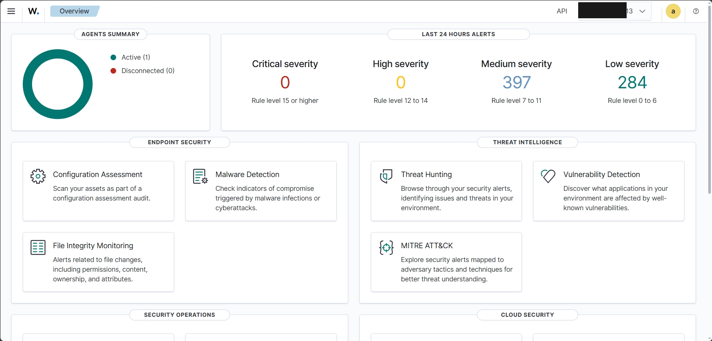
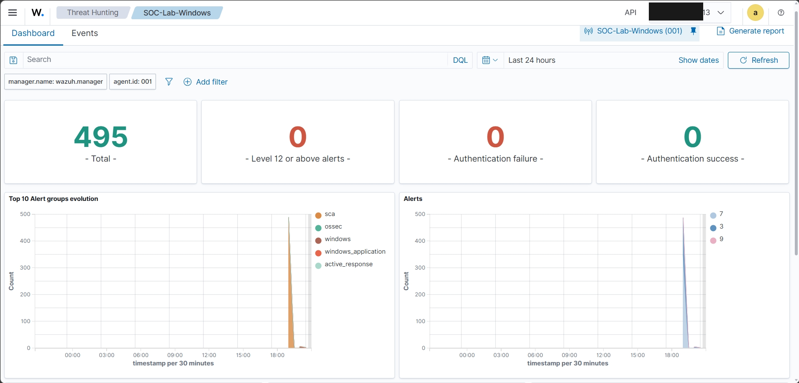
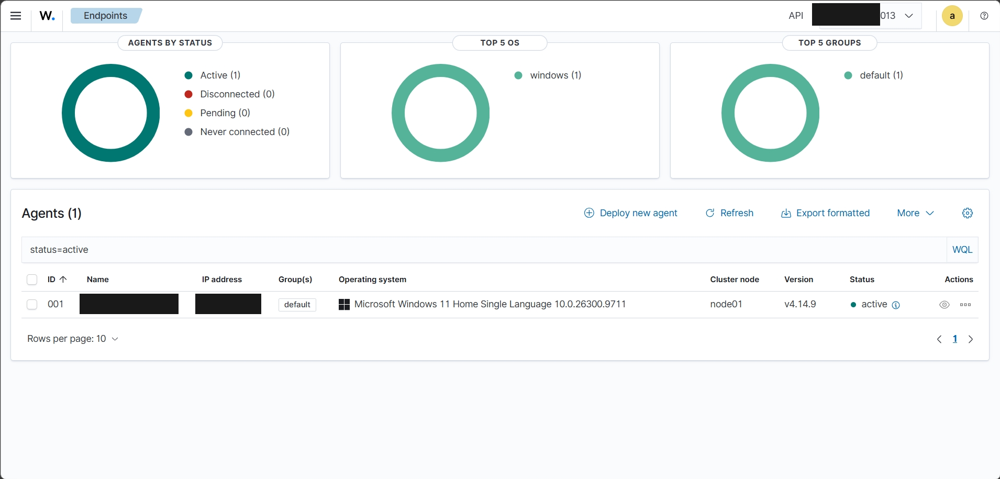
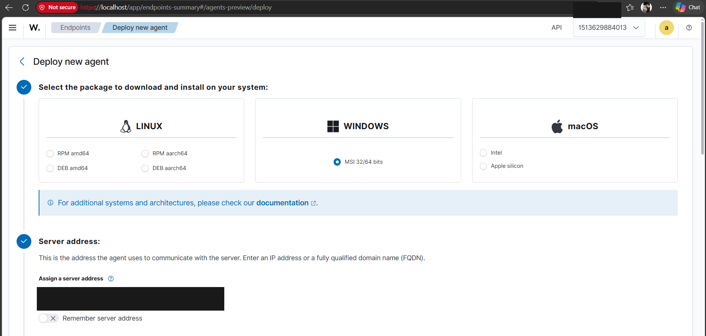
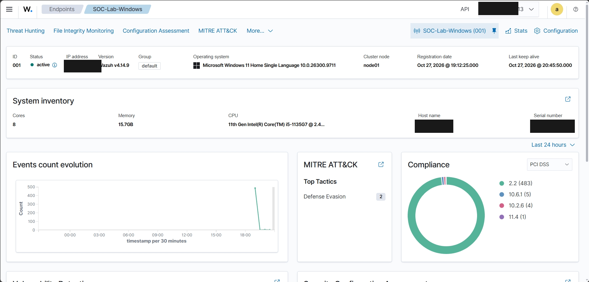
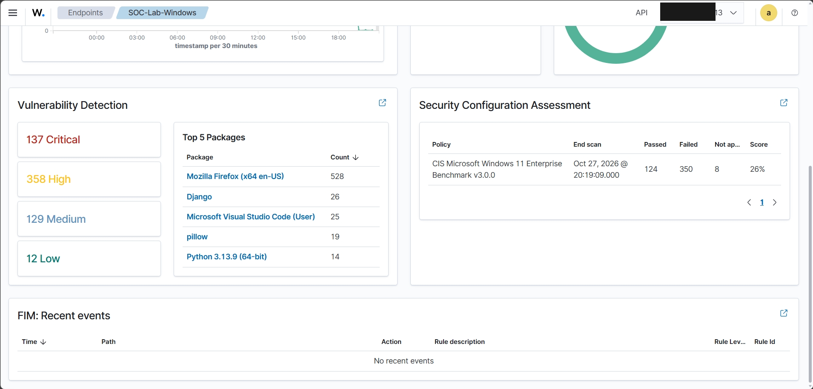
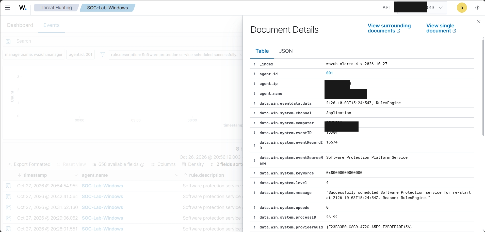
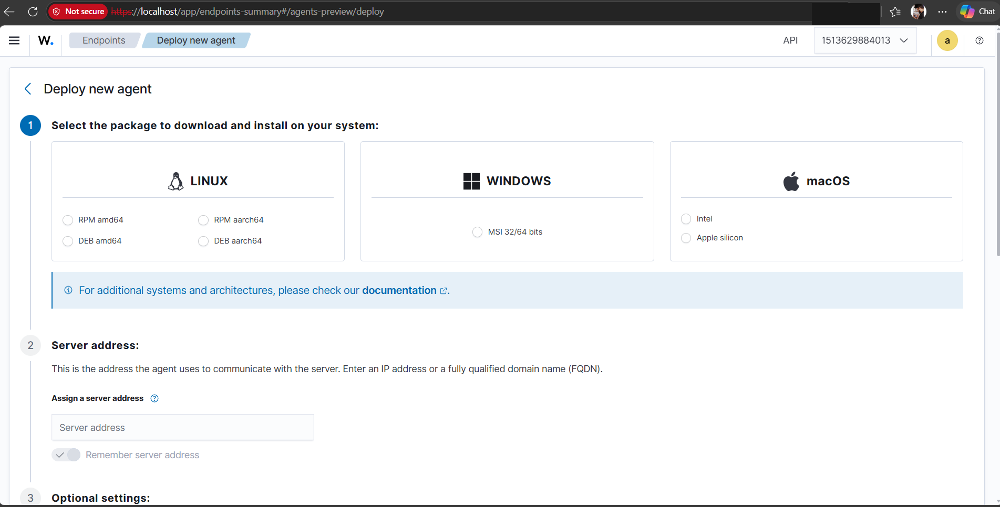
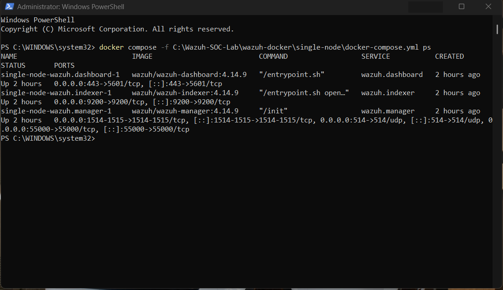

# 🛡️ Wazuh SOC Home Lab

### Windows Endpoint Security Monitoring & SIEM Investigation

  
  
  
  

**A hands-on SOC home lab project demonstrating SIEM deployment, Windows endpoint monitoring, and security event investigation using Wazuh.**

---

## 📌 Project Overview

This project demonstrates the deployment and exploration of a Security Information and Event Management (SIEM) environment using **Wazuh**.

A single-node Wazuh environment was deployed using Docker on Windows 11. A Windows endpoint agent was registered with the Wazuh manager to collect and monitor Windows event logs.

The project provided practical experience with endpoint monitoring, event collection, dashboard navigation, and basic security event investigation.

## 🎯 Project Objectives

* Understand SIEM fundamentals and SOC monitoring workflows.
* Deploy a Wazuh single-node environment using Docker.
* Connect and register a Windows endpoint agent.
* Monitor Windows Application, Security, and System event logs.
* Explore collected events using the Wazuh dashboard.
* Understand how endpoint events are presented for investigation.

## 🧰 Tools & Technologies

  
  
  
  

| Tool                 | Purpose                                 |
| -------------------- | --------------------------------------- |
| Wazuh 4.14.9         | SIEM and endpoint security monitoring   |
| Docker Desktop       | Container-based deployment              |
| Windows 11           | Endpoint operating system               |
| Wazuh Dashboard      | Monitoring and event investigation      |
| Windows Event Viewer | Verification of Windows event logs      |
| PowerShell           | Running setup and verification commands |

## 🖥️ Lab Environment

| Component     | Configuration                 |
| ------------- | ----------------------------- |
| Host OS       | Windows 11                    |
| Processor     | Intel Core i5-1135G7          |
| RAM           | 16 GB                         |
| Storage       | 1 TB SSD                      |
| SIEM Platform | Wazuh 4.14.9                  |
| Deployment    | Single-node Docker deployment |
| Endpoint      | Local Windows machine         |
| Agent Name    | SOC-Lab-Windows               |

## ⚙️ Implementation Steps

### 1. Wazuh Deployment

* Deployed the Wazuh single-node environment using Docker.
* Accessed the Wazuh dashboard locally.
* Verified that the dashboard was accessible.

### 2. Windows Agent Registration

* Installed the Wazuh agent on the Windows endpoint.
* Registered the endpoint with the Wazuh manager.
* Verified the agent status as Active.
* Used the agent name `SOC-Lab-Windows`.

### 3. Windows Event Log Monitoring

Configured the Windows agent to monitor:

* Application logs
* Security logs
* System logs

### 4. Event Investigation

* Explored Windows events collected by Wazuh.
* Reviewed event details and rule information.
* Examined routine Windows Application events.
* Compared a custom test event in Windows Event Viewer with the Wazuh dashboard.

## 🔍 Observations & Findings

During the lab exercises:

* The Windows endpoint successfully registered with Wazuh.
* The agent appeared as Active in the dashboard.
* Windows Application events were collected and displayed.
* Event ID 16384 was observed with Wazuh rule level 3.
* A harmless custom Windows Application event was created for testing.

**Testing limitation:** The custom test event was visible in Windows Event Viewer, but I could not confirm that it appeared in Wazuh Threat Hunting. Therefore, this project does not claim successful detection of that custom event or a simulated attack.

## 📸 Project Screenshots

### 1. Wazuh Dashboard Overview

### 2. Security Events Overview

### 3. Windows Agent Overview

### 4. Wazuh Server Configuration

### 5. Windows System Inventory

### 6. Security Monitoring Events

### 7. Wazuh Event Details

### 8. Wazuh Setup Process

### 9. Docker Setup Commands

## 🧠 Skills Demonstrated

* SIEM fundamentals
* Wazuh deployment and dashboard navigation
* Windows endpoint monitoring
* Windows Event Log analysis
* Security event investigation
* Docker fundamentals
* PowerShell fundamentals
* Basic SOC monitoring concepts

## 📚 Key Learnings

* Understanding how SIEM platforms collect and display endpoint logs.
* Learning how to register and monitor a Windows endpoint.
* Exploring Windows Application, Security, and System events.
* Understanding event details and Wazuh rule levels.
* Gaining practical exposure to a basic SOC monitoring workflow.

## 🚀 Conclusion

This project provided hands-on exposure to SIEM deployment and Windows endpoint monitoring using Wazuh.

It strengthened my understanding of security event collection, endpoint monitoring, and basic event investigation processes used in Security Operations Centers.

## 📄 License

This project is licensed under the [MIT License](LICENSE).

---

**⭐ Thank you for visiting my project!**

